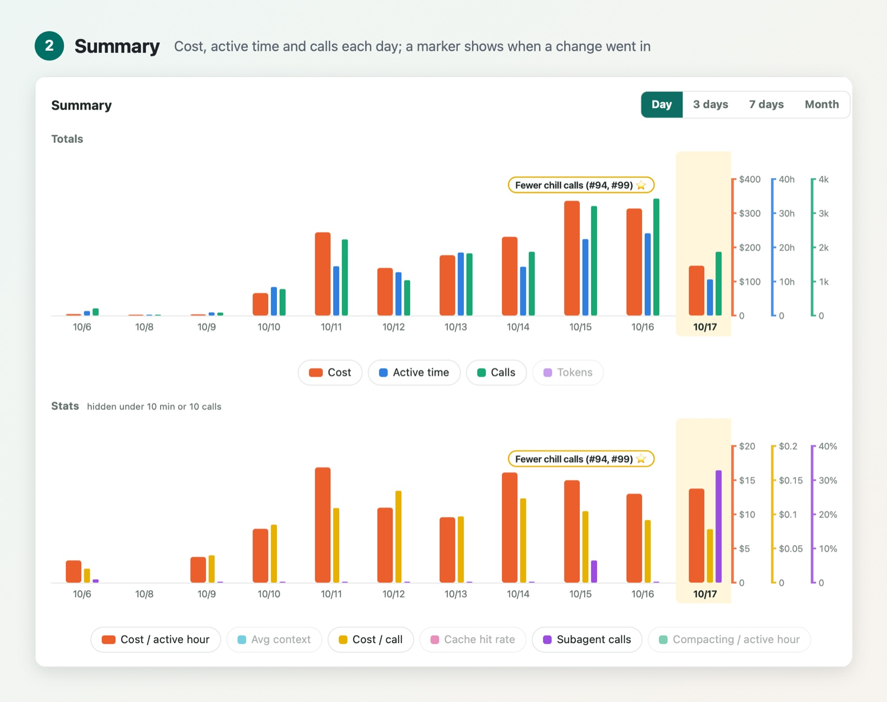
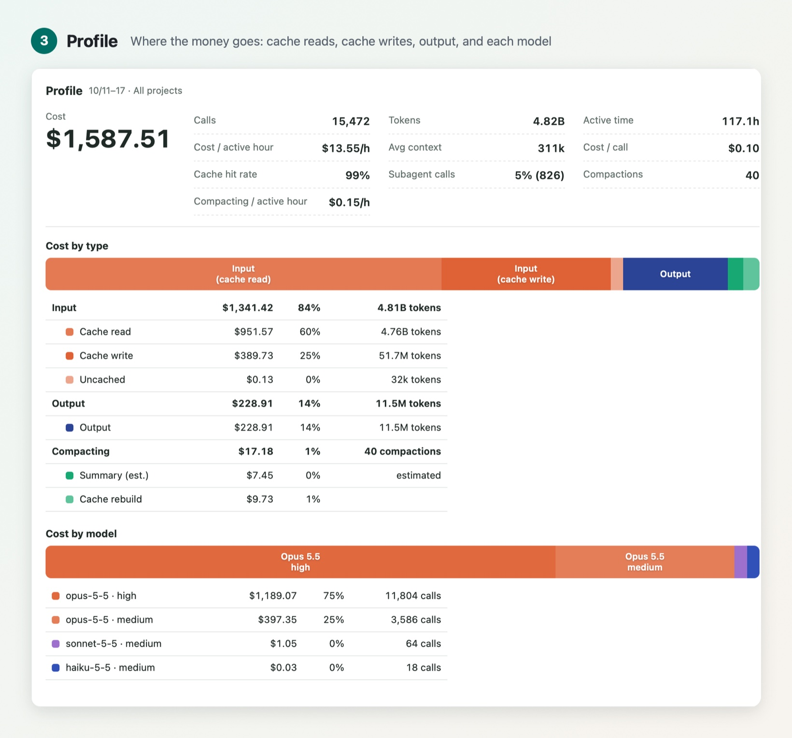
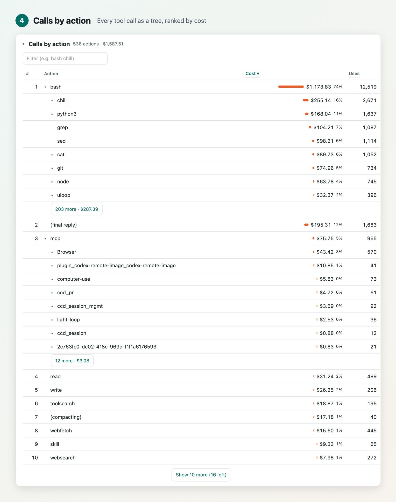
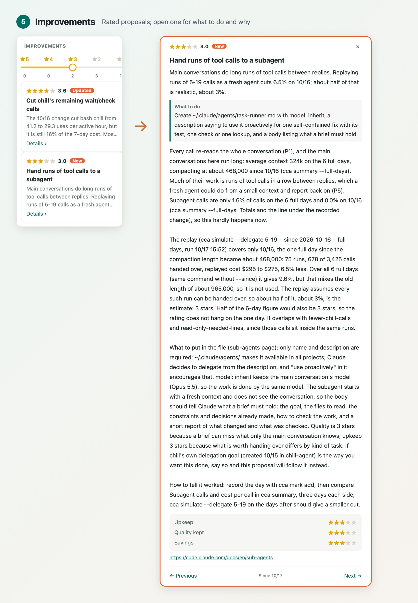

<p align="center">
  
</p>

<h1 align="center">Cost Adviser For Claude</h1>

<div align="center">

[](https://github.com/game-dev-rta-club/cost-adviser-for-claude/actions/workflows/ci.yml)
[](https://github.com/game-dev-rta-club/cost-adviser-for-claude/releases/latest)
[](LICENSE)

</div>

**See where your Claude Code money goes—and what to change.**

A command-line tool and an agent skill for Claude Code. `cca` turns the conversation records Claude Code already keeps on your machine into a report. The `cost-adviser` skill reads that report with your agent and keeps a short list of improvements, each rated so you can weigh it. Nothing is sent anywhere.

## How it works

### 1. Run the cost-adviser skill

Ask your agent to use the skill, and it diagnoses your costs. It refreshes the report, takes the numbers as clues, looks at what happened in the conversations behind them, explains it with basic principles, and updates the list of improvements. It replies with each improvement in a sentence or two, and a link that opens its details in the report.

```text
/cost-adviser
```

Every tool call makes the model read the whole conversation again. So cost is the **number of calls × what each call reads × the price per token**, plus the cache written again after it expires. The report below breaks the cost down along each of these.

### 2. Check performance in Summary

Cost, active time and calls for each day, with ratios such as cost per active hour and cost per call. A marker shows the day you recorded a change, so you can see whether it worked.



### 3. Analyze it in Profile

Where the money goes for the chosen days: cache reads, cache writes, output and compacting, then each model and effort level. Here, reading the conversation again from the cache is 60% of the cost, and output only 14%.



### 4. See the costly commands in Calls by action

Every tool call as a tree, ranked by cost. Commands that share their first words add up (`bash › chill › connection › wait`), so one repeated step stands out even when each use is cheap.



### 5. Get improvements in Improvements

The skill keeps a short list of improvements, each rated one to five stars on upkeep, quality kept and savings. Open one to see what to do, why, the numbers behind it, and how to tell whether it worked.



- **Four angles:** fewer calls, less read per call (a smaller conversation, or tool use handed to an agent with little context), a lower price, and the cache kept.
- **A steady list:** an improvement changes only when its numbers or facts do, so a change on the report means something.
- **Measured before you change anything:** `cca simulate` replays your recent conversations as if a change had been in place, such as an earlier compaction, shorter tool results, or work handed to a fresh agent.

## Install and use

```sh
npm install -g github:game-dev-rta-club/cost-adviser-for-claude
npx skills@latest add game-dev-rta-club/cost-adviser-for-claude \
  --skill cost-adviser \
  --agent claude-code \
  --yes
```

The first line installs `cca`; the second adds the skill to your project. Then, in Claude Code:

```text
/cost-adviser
```

Or look for yourself:

```sh
cca build --open    # write the report and open it
cca summary         # the same as text: this week against the last
```

**Requires:** Claude Code and Node.js 20 or later. No other dependencies. `cca` reads `~/.claude/projects` and writes only to `~/.cost-adviser-for-claude`. Costs are estimates at list prices per model; on a subscription, they show what the same use would cost through the API.

Every command and how each number is counted: [Reference](docs/reference.md).

## Update

Rerun the install commands to update. See the [release notes](CHANGELOG.md).

## Project

[Game Dev RTA Club](https://github.com/game-dev-rta-club) · [MIT](LICENSE) · [Contributing](CONTRIBUTING.md) · [Code of Conduct](CODE_OF_CONDUCT.md) · [Security](SECURITY.md)
